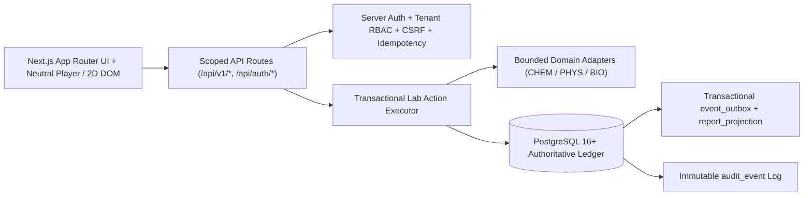

# G1 Virtual Labs — Architecture

## 1. High-Level Overview

G1 Virtual Labs is structured as a single Next.js 16 (App Router + TypeScript strict) web application backed by a real PostgreSQL 16+ relational ledger (`pg`). In zero-config local Windows development, PostgreSQL is served via an embedded `@electric-sql/pglite` + `@electric-sql/pglite-socket` process (`scripts/db-server.mjs`) listening on `127.0.0.1:54329` with persistent disk storage at `.data/pgdata`. Switching to a standalone PostgreSQL 16+ server requires changing only `DATABASE_URL` in `.env.local` with zero application code changes.



## 2. Technology Choices & Tradeoffs

| Layer | Selection | Tradeoff / Rationale |
|---|---|---|
| Web Framework | Next.js 16 (App Router, React 19, TypeScript strict) | Server-rendered accessible pages for fast school loads + colocated Route Handlers implementing `/api/v1/*` with zero cross-origin complexity. |
| Database Driver | Raw `pg` (`node-postgres`) + SQL migrations (`db/migrations/001_initial_schema.sql`) | Avoids ORM lock-in and executes the exact 35-table composite-tenant PostgreSQL DDL from `specs/database_schema.sql` (including `FOR UPDATE` row locking and partial unique index `first_assessment_per_rubric`). |
| Local PostgreSQL Engine | `@electric-sql/pglite-socket` (dev/local) → external PostgreSQL 16+ (staging/prod) | Zero Windows global installs or Docker required, while exercising genuine PostgreSQL wire protocol, constraints, JSONB, and ACID transactions. |
| Validation | Zod v4 (`zod@4.6.7`) at API boundaries + Ajv 2020-12 in schema contract tests | Runtime type safety with zero production npm vulnerabilities, verified directly against the 4 Draft 2020-12 research JSON Schemas. |
| Styling & Typography | Tailwind CSS v4 + CSS Custom Property Design Tokens (`globals.css`) + `Inter` & `Noto Sans Telugu` | Self-hosted fonts via `next/font/google` (zero runtime third-party font requests), exact fidelity to the 7 approved reference screens, WCAG 2.2 AA contrast. |
| Testing | Vitest + Playwright + `@axe-core/playwright` | Deterministic unit/science/contract tests paired with live browser E2E, cross-tenant negative security checks, and automated WCAG 2.2 AA scans. |

## 3. PostgreSQL Schema Note (Research DDL Defect Fixed)

Executing `specs/database_schema.sql` directly against PostgreSQL revealed an implicit column-count mismatch in `experiment_version` and `experiment_model` foreign keys (referencing composite `UNIQUE` constraints rather than the 2-column primary keys). In `db/migrations/001_initial_schema.sql`, explicit referenced column lists (`REFERENCES experiment(experiment_id, subject)`, `REFERENCES experiment_version(experiment_id, content_version, subject)`, `REFERENCES model_version(model_id, version, subject)`) were added so the schema applies cleanly to PostgreSQL 16+.

In addition to the canonical 35 research tables, migration `001_initial_schema.sql` adds minimal platform tables:
- `principal_credential` (local `scrypt` salted password hashes + `is_synthetic` flag)
- `auth_session` (HMAC-hashed HTTP-only session tokens + per-session CSRF token + active role/school/district scope)
- `idempotency_record` (transactional idempotency storage for launch, redeem, assignment publish, and submission)
- `editorial_review` (includes PostgreSQL `CHECK (reviewer_principal_id IS NULL OR reviewer_principal_id <> editor_principal_id)` enforcing two-person publication at the database layer)
- `school_device_profile` (classroom 4/8/16 GB device readiness metadata)

## 4. Security & Tenant Isolation Model

- **Authentication:** `scryptSync` password hashing (`timingSafeEqual`), HMAC-SHA256 hashed session token stored in `HttpOnly; SameSite=Lax` cookie (`g1_session`), sliding-window rate limiting on `/api/auth/sign-in`.
- **CSRF:** Double-submit / session-bound `X-CSRF-Token` verified with `timingSafeEqual` on every mutating route.
- **Tenant & Class Isolation:** Every query against school-scoped resources filters by `auth.schoolId` and verifies `class_teacher` or `enrollment` membership. Cross-school and unauthorized same-school cross-class reads return masked HTTP `404 NOT_FOUND`.
- **Launch Grant Hardening:** `POST /api/v1/launch` verifies exact `manifestSha256` and `engineAbi` (`lab@1`) and stores only `sha256(launchToken)` in `launch_grant` (5-minute TTL). `POST /api/v1/launch/redeem` accepts token strictly in same-origin POST body (never query string), locks the row `FOR UPDATE`, marks `redeemed_at`, and audits replay attempts (`409`).
- **Exactly-Once Grading:** Enforced atomically by `lab_session` row lock + idempotency key + PostgreSQL partial unique index `first_assessment_per_rubric ON assessment(school_id, attempt_id, rubric_version) WHERE supersedes_id IS NULL`.

## 5. Directory Structure

```text
e:\G1 Virtual Labs website\
├── db/migrations/           # PostgreSQL 16+ SQL migrations
├── docs/                    # Current contact, operational and curriculum documentation
├── project-brief/           # Required curriculum and experiment source fixtures
├── public/
│   ├── brand/               # Canonical G1 logo (278x50) & cropped monogram favicon
│   └── assets/labs/         # Approved concept SVGs & subject photographs
├── scripts/                 # Embedded Postgres socket server, migrate, seed, reset, run-local
├── specs/                   # OpenAPI 3.1, 4 Draft 2020-12 JSON Schemas, science_models.json
├── src/
│   ├── app/                 # Next.js App Router pages & /api/* Route Handlers
│   ├── components/          # Modular UI components (BrandLogo, AppHeader, LabPlayerClient, etc.)
│   └── lib/                 # db, crypto, auth, catalog, science-adapters, i18n, types
└── tests/
    ├── unit/                # Vitest unit & Ajv JSON Schema contract suites
    └── e2e/                 # Playwright E2E + Axe WCAG 2.2 AA + cross-tenant security tests
```
